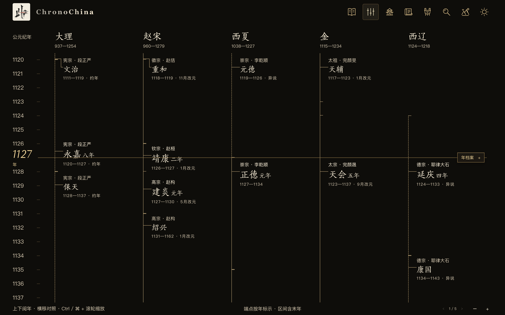
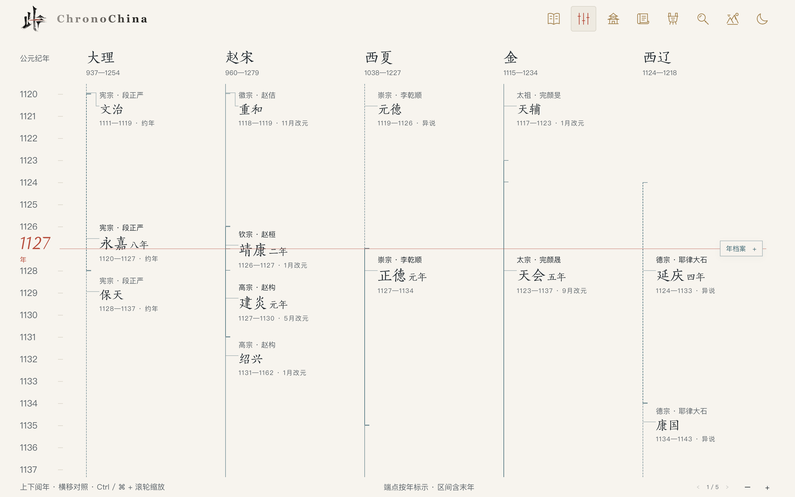
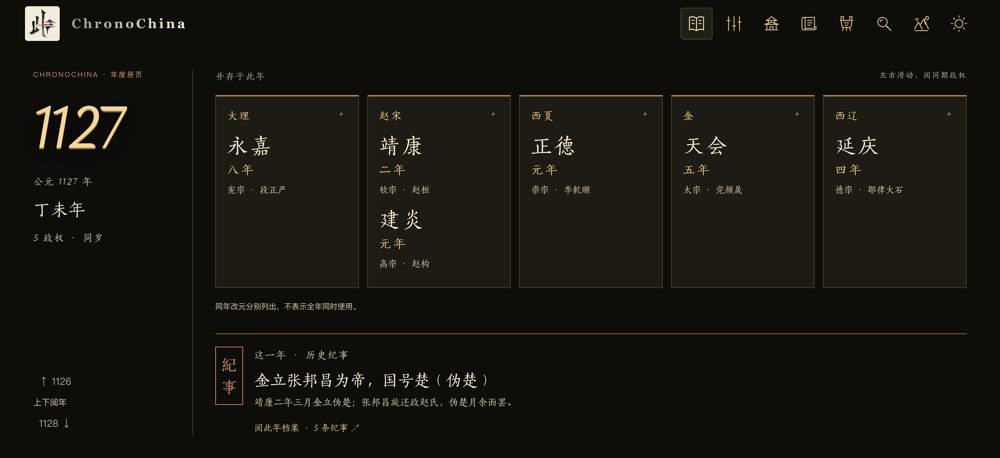
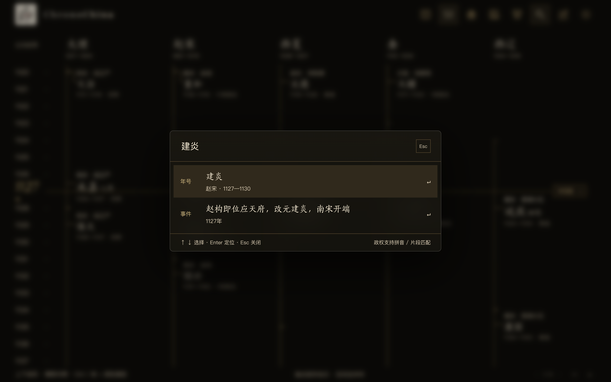

English · [简体中文](README.md)

<p></p>

# 此年 · ChronoChina

**此年，山河同阅。** — *One year, many realms; read them side by side.*

## Why I built this

I mostly work with spatial data, so my first instinct is to put everything into a coordinate system: an origin, a scale, and only then does a position mean anything. Reading history, I kept missing the equivalent for time — dynasties are written volume by volume, and so they get read volume by volume.

The first thing that tripped me up was a simple question: which era names were actually in use in 1127? The answer spans several volumes. The Song went from Jingkang to Jianyan, the Jin were already in Tianhui, Western Xia in Zhengde, Qara Khitai in Yanqing, Dali still in Yongjia. Different books, same year — and I had to stack them in my head to see it.

So this site starts by aligning the ruler: give it a year, then read every regime that existed in that year side by side. When you want to dig in, each era can be traced to its sources, and years with no data are marked as blank, not as "nothing happened". Line the ruler up and settle the rules, and reading history stops giving you heartburn.

It deliberately is not a map, and not a decorative scroll. "此年，山河同阅" is both the framing and the constraint: give the simultaneity back to history, and leave the judgement to you.

## Project name

- **Site name**: 此年 · ChronoChina (ChronoChina = Chronology + China)
- **Slogan**: 此年，山河同阅。
- **Logo**: a seal-style 「此年」 stamp, see `public/favicon-art.png`

## Overview

A chronological atlas of Chinese history. It builds one shared time coordinate: pick any year and you see the Gregorian year, the sexagenary (ganzhi) cycle, every regime alive in that year, each one's era name and ruler, and what happened.

Unlike an exhibition-style timeline, every entry here can be located, checked, and traced to a source. Disputed dates are dashed, approximate years are flagged, and missing coverage is stated as missing. All data is static JSON — no backend, no database, no runtime requests.

It is for anyone who wants to know how many regimes existed in a given year and what each of them called it — and for teaching or writing that needs a date reference you can verify.

## Live demo

> Not deployed yet. Run it locally (see [Getting started](#getting-started)), or host `dist/` on GitHub Pages / Cloudflare Pages / Vercel — the build is fully static, and `base: './'` works from a subpath.

## Screenshots

**Chronological view, dark** — a vertical time canvas: fixed year pointer, contemporary regimes side by side.



**Chronological view, light** — same layout in paper white and ink, with the current year in cinnabar.



**Reading** — one page per year: the year in Chinese numerals, ganzhi, panels for each coexisting regime, and the events of that year.



**Search** — `Ctrl / ⌘ + K` opens a centered glass palette for years, era names, ganzhi, people and pinyin.



## Core features

- **Reading (阅年)** — one page per year: the year written out in Chinese numerals, ganzhi, and the number of coexisting regimes. Scroll, `↑ ↓` or swipe to page through years; expand a regime panel for its era name, ruler and change-of-era month; the year dossier collects events, contemporary era names, and people alive or born/died that year.
- **Chronological view (并世)** — the cinnabar year in the middle *is* the current year: scroll to move, click to type a year. Each regime alive that year gets a column; scroll sideways or use `‹ ›` to jump a screen. Era brackets follow real start/end years, short spans pull their labels out with connector lines, disputed or approximate dates are dashed. `Ctrl / ⌘ + wheel` changes time density.
- **Year dossier** — a floating record you can drag, resize from eight handles, adjust paper opacity, and pin to the side; it follows the current year.
- **Dynasty menu** — six periods from Qin–Han to Ming–Qing; any regime jumps straight to its founding year and sets the comparison window.
- **Era database** — regime, ruler, era name, start/end, ganzhi, change-of-era month, disputes and sources in one table, with filters and CSV export.
- **Heritage** — 82 selected sites, filterable by category, dynasty and keyword, each able to jump back to its founding era.
- **Search** — years (`1127`, `221 BC`), era names (`Jianyan 1`, `Shaoxing`), ganzhi (`丁未`), people and aliases (`Qin Shi Huang`), regime pinyin (`donghan`), and fuzzy fragments.
- **Light / dark** — paper white or ink-and-gold, remembered across visits; both themes share one layout.

## Tech stack

| Layer | Choice |
|---|---|
| Frontend | React 18, TypeScript (strict), plain CSS with custom properties |
| Build | Vite 5 |
| Time mapping | d3-scale (years ↔ pixels) |
| Data | Static JSON imported at build time; no backend, no database |
| Data tooling | Node ESM + cheerio (import and validation scripts only) |

## Getting started

Requires Node.js 18+.

```bash
npm install
npm run dev        # dev server at http://localhost:5173
npm run build      # type-check + data validation + build to dist/
npm run preview    # preview the production build
```

Data-related commands:

```bash
npm run validate   # data checks (required after editing data/*.json; build runs it too)
npm test           # regression tests for dates, conversion, search and dossier layout
```

## Project structure

| Path | Purpose |
|---|---|
| `data/` | Static data: regimes, rulers, era names, events, people, sites, sources |
| `data/curated/` | Hand-curated overrides, highest priority |
| `scripts/` | Data import, validation and regression scripts |
| `public/` | Fonts, original icon artwork, site icons |
| `src/views/` | Reading, chronological view, era database, heritage |
| `src/components/` | Search palette, year dossier, year panel, icons |
| `src/lib/` | Data access, time and ganzhi, search, conversion |
| `src/styles.css` | Layout and light/dark theming |
| `docs/preview/` | README screenshots |
| `index.html` | Entry page |

## Roadmap

**Shipped**

- Full era-name import (36 regimes / 242 rulers / 540 era names), with ganzhi cross-checked against the algorithm entry by entry;
- Event library of 753 entries across 555 years, linked with 78 people's birth and death years;
- Chronological view, reading view, era database, heritage, glass search and year dossier;
- Dual themes sharing one layout; data validation and regression tests.

**Planned**

- Fill in the Sixteen Kingdoms, Ten Kingdoms, and Qara Khitai era names after 1143;
- Event category filters and individual ruler pages;
- History–geography link: a site map plus deep links to an external historical map, rather than building a boundary map here;
- Expand heritage from a curated set toward the full national protection list.

## Contributing

- **Report an issue**: open an [issue](https://github.com/Linqiyu-0921/ChronoChina/issues) with what you saw, your browser and the steps; for historical questions, include sources.
- **Send a change**: fork, branch, keep the change focused. If you touch `data/*.json`, run `npm run validate` first, and run `npm run build` and `npm test` before opening a PR.
- **Historical accuracy**: unsourced date changes are not accepted; disputed readings must be marked `disputed` with their evidence; do not auto-convert lunar dates to Gregorian days.

## License

| Part | License |
|---|---|
| Code | [MIT](LICENSE) |
| Data (`data/`) | [CC BY-SA 4.0](LICENSE-DATA.md) |
| Icons and gold line artwork (`public/assets/icons/`) | CC BY 4.0 |
| Fonts (`public/fonts/`) | Third-party fonts, not covered by this repository's licenses |

When reusing or adapting, keep the credit **此年 · ChronoChina (Linqiyu)**; if you use the data, also keep the Wikipedia *Timeline of Chinese History* (CC BY-SA 4.0) attribution.

## Credits

- Event chronology referenced from [Wikipedia: Timeline of Chinese history](https://zh.wikipedia.org/wiki/中国历史年表) (CC BY-SA 4.0; all event text independently rewritten);
- Era start/end and disputed readings cross-checked against [Y. T. Liu's Chinese calendar tables](https://ytliu0.github.io/ChineseCalendar/era_names_simp.html);
- Era data imported from the [Chinese dynastic era table](https://home.olemiss.edu/~gg/lidaijiy.htm);
- Heritage entries reference the UNESCO World Heritage list and China's national protection lists;
- Open-source dependencies: [React](https://react.dev/), [Vite](https://vite.dev/), [d3-scale](https://github.com/d3/d3-scale);
- The site typeface is a Song-style face (simplified and traditional), bundled with the project — confirm its license before redistributing.
