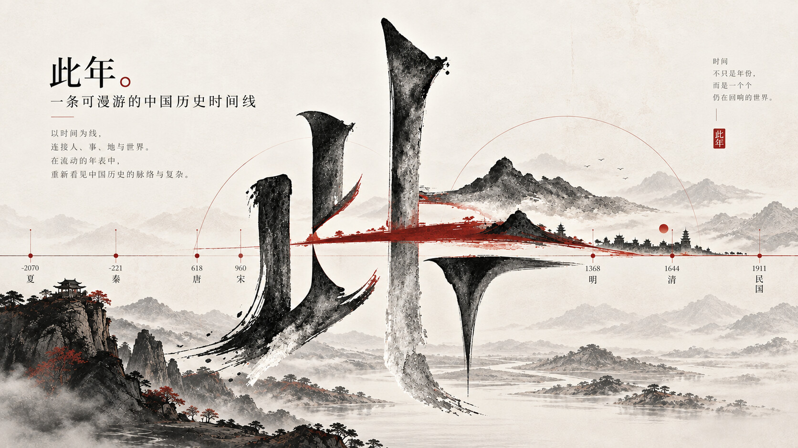

English · [简体中文](README.md)

<p></p>

# ChronoChina · 此年

**此年，山河同阅。** — *One year, many realms; read them side by side.*



## Why I built this

Reading history books, historical fiction, or the standard histories, these questions come up again and again:

- *Which year is the twelfth year of Shaoxing?* — first recall the first year of Shaoxing, then count twelve years forward yourself.
- *Which year is dingwei?* — the sexagenary cycle repeats every sixty years, so two characters alone never tell you which dynasty you are in.
- *Who was actually using the Qianzhen era in its first year?* — after flipping through several dynastic volumes, it turns out to be Yang Pu of Wu.

None of these asks "what happened". They ask "in this one year, who existed, and what did each of them call it". Histories are written volume by volume, so readers have to stack the same year from different volumes back into one line inside their heads.

I mostly work with spatial data, so my first instinct is to put everything into one coordinate system: an origin, a scale, and only then does a position mean anything. Time deserves the same ruler. So this site gives you the year first, then lays the coexisting regimes, era names, and events side by side — searchable, checkable, and traceable to sources.

It deliberately is not a map, and not a decorative scroll. "此年，山河同阅" is both the framing and the constraint: give the simultaneity back to history, and leave the judgement to you. Line the ruler up, settle the rules, and reading history stops giving you heartburn.

## Live demo

**<https://cinian.laneqiyu.cn>** — hosted on Cloudflare Pages (mirror: <https://chronochina.pages.dev>). The build is fully static, and `base: './'` works from any subpath.

## How to use it

The three questions above, one search each:

| Question | Do this | You get |
|---|---|---|
| Which year is the twelfth year of Shaoxing? | `Ctrl / ⌘ + K`, type `绍兴十二年` | 1142: Song, Shaoxing 12 — alongside Jin Huangtong 2, Western Xia Daqing 3, Qara Khitai Kangguo 9, Dali Guangyun |
| Which year is dingwei? | Type `丁未` | Every dingwei year in range (1127, 1067, 1007 …), repeating every sixty years; pick one to enter |
| Who used Qianzhen in its first year? | Type `乾贞` | 927: Wu, Yang Pu, Qianzhen 1 — alongside Later Tang Tiancheng 2, Wuyue Baozheng, Southern Han Bailong 3, Liao Tianxian |

Land on a year and you are in Reading (阅年): scroll up and down to change the year, read the coexisting regimes across; open any regime to see its era name, ruler, span, and month of change, and flip out the annual dossier at the bottom for that year's events, contemporary eras, and people alive. For a multi-year comparison, switch to Timeline (并世).

## Screenshots

**Reading (阅年), dark**: one year per page, laid out like an almanac. The year leads and the ganzhi follows; contemporary regimes are numbered 01—05 from south to north by the latitude of their capital, and a one-line epigraph states the year's shape.


**Reading (阅年), light**: the same page on paper white — vermilion and gold only on the year, the seals, and the rules.


**Timeline (并世), dark**: a vertical time canvas. Gregorian years on the left, a vermilion line at the current year, and one exhibition label per surviving regime, with era names drawn as duration bars at their true start and end.


**Timeline (并世), light**: the same ruler, a different paper.


**Search, browse**: with an empty box it is a table of contents — six periods and their regimes.


**Search, query**: type an era name, year, ganzhi, person, or pinyin, press Enter, and land on that year.


## Features

- **Reading (阅年)** — one year per page: the year, its ganzhi, and how many regimes stood at once; the epigraph is generated from that year's era changes ("丁未之年，五政权并立；赵宋改元建炎，西夏改元正德。"); regimes are ordered south to north by the latitude of their capital, with no "orthodox" side assumed; expand one to see its era name, ruler, span, and month of change; turn pages with the wheel / `↑ ↓` / swipe.
- **Timeline (并世)** — vertical multi-year comparison: Gregorian years on the left, a vermilion line at the current year; each surviving regime gets a column with an exhibition label, ordered south to north, era names are drawn as duration bars at their true extent, and regimes crossing the current year open their era, ruler, and month of change; `Ctrl / ⌘ + wheel` changes time density, `‹ ›` pages through regime groups.
- **Search** — `Ctrl / ⌘ + K`: empty means browse by period and regime, and a click jumps to the founding year with the comparison window kept; typing searches years (`1127`, `前221`), era names with an ordinal (`建炎元年`, `绍兴十二年`), ganzhi (`丁未`), person aliases (`秦始皇`), and regime pinyin (`donghan`).
- **Chronology reference** — polities, rulers, era names, spans, ganzhi, months of change, disputes, and sources in one table, filterable and exportable to CSV.
- **Heritage** — 162 selected sites, filterable by category / dynasty / keyword, each linking back to its founding year.
- **Annual dossier** — a floating record you can drag, resize on all eight handles, fade, or dock to the side; it follows the current year, and ruler names open a ruler dossier.
- **Interface languages** — Simplified Chinese / Traditional Chinese / English, following the browser on first visit and remembering your choice; Traditional also converts the historical data, while English translates only the interface and keeps regime, era, and event names in Chinese.
- **Themes** — paper white and ink-black with gold share a single layout; only the paper changes, never the grid. Your choice is remembered.
- **Keyboard and accessibility** — a "skip to content" link leads straight to the main view; `Esc` closes the search or the dossier and returns focus; search is a `combobox` navigable with arrow keys.

This site draws no borders. For territory maps of a given period, see [Jiangshan Map](https://deanchen.me/jiangshan-map/).

## Data and accuracy

- Coverage 769 BCE — 1911: 90 polities and 1,107 reign records (746 of them carry an era name), including the Spring and Autumn and Warring States states, minor Sixteen Kingdoms offshoots, the Ten States and other regional regimes, plus Tubo, Nanzhao, Uyghur, Balhae, Silla, and Khitan.
- 5,345 events across 2,200 years, 668 selected people, and 162 heritage sites.
- Every era name and event carries sources; disputed dates (`disputed`) and approximate ones (`approx`) are distinguished in the interface by dashed lines and badges; years with no data are left blank — blank does not mean nothing happened.
- Internal time is stored as astronomical year integers (1 BCE = 0); ganzhi is computed, never stored; months of era change follow the original record and are never auto-converted to Gregorian days.
- Passing validation is not historical certification: events, people, and heritage still await entry-level review.

## Getting started

Requires Node.js 18+.

```bash
npm install
npm run dev        # dev server at http://localhost:5173
npm run build      # type check + data validation + build to dist/
npm run preview    # preview the build
```

Data commands:

```bash
npm run validate   # data validation (required after editing data/*.json; build runs it too)
npm test           # regression tests for dates, conversion, search, and dossier layout
```

## Project structure

| Path | Purpose |
|---|---|
| `data/` | static data: polities, rulers, eras, events, people, heritage, sources |
| `data/curated/` | hand-curated overlays, highest priority |
| `scripts/` | data import, validation, regression tests |
| `src/views/` | reading, timeline, chronology reference, heritage |
| `src/components/` | search palette, annual dossier, year panel, ruler dossier, category filter |
| `src/lib/` | data access, time and ganzhi, search, conversion |
| `src/styles.css`, `src/reading-collections.css` | global layout, reading pages, and reference styling |
| `public/` | fonts, icon originals, site icons |
| `docs/preview/` | screenshots used in the README |
| `docs/assets/` | cover image for the README and external showcases |

## Roadmap

**Done**

- reign data for 769 BCE — 1911: 90 polities / 825 rulers / 1,107 reign records, with ganzhi cross-checked entry by entry;
- minor Sixteen Kingdoms offshoots (Ran Wei, Western Yan, Zhai Wei, Dai), the regional regimes beyond the Ten States (Qi, Jie Yan, Qingyuan, Guiyi), and Tubo, Nanzhao, Uyghur, Balhae, Silla, and Khitan;
- 5,345 events linked to 668 people's birth and death, plus 162 selected heritage sites;
- almanac-style reading page, vertical timeline, chronology reference, heritage, glass search, annual dossier, and ruler dossier;
- matching light and dark layouts, data validation, and regression tests.

**Planned**

- add the remaining short-lived polities and regional era names;
- entry-level source review and dispute notes for reign records;
- expanding heritage toward the full national key heritage register, with coordinate linking (no borders of our own; territory maps link out to Jiangshan Map);
- month-level lunar–Gregorian conversion.

## Contributing

- **Report a problem**: open an [issue](https://github.com/Linqiyu-0921/ChronoChina/issues) with the symptom, browser, and steps; attach sources for historical corrections.
- **Send a change**: fork, branch, keep each change focused; run `npm run validate` before touching `data/*.json`, and run `npm run build` and `npm test` before opening a PR.
- **Historical standards**: no undated sources, no silent edits; disputes must set `disputed` with the reasoning; lunar dates are never converted to Gregorian days automatically.

## License

| Part | License |
|---|---|
| Code | [MIT](LICENSE) |
| Data (`data/`) | [CC BY-SA 4.0](LICENSE-DATA.md) |
| Icons and gold line art (`public/assets/icons/`) | CC BY 4.0 |
| Fonts (`public/fonts/`) | third-party fonts, not licensed with this repository |

Please keep the attribution **此年 · ChronoChina (Linqiyu)** when reposting or adapting; data also requires attribution to the Wikipedia source listed below.

## Credits

- event chronology follows [Wikipedia: 中国历史年表](https://zh.wikipedia.org/wiki/中国历史年表) (CC BY-SA 4.0; all text independently rewritten);
- era spans and disputed dates checked against [Y. T. Liu's Chinese chronology tables](https://ytliu0.github.io/ChineseCalendar/era_names_simp.html);
- era data imported from [中国历代纪元表](https://home.olemiss.edu/~gg/lidaijiy.htm);
- heritage entries draw on the UNESCO World Heritage list and the public national key heritage register;
- for territory and place names, see [Jiangshan Map](https://deanchen.me/jiangshan-map/) by Dean Chen;
- open-source dependencies: [React](https://react.dev/), [Vite](https://vite.dev/), [d3-scale](https://github.com/d3/d3-scale);
- the typography uses a Song-dynasty style face (simplified / traditional) bundled with the site; check its license before redistributing.
