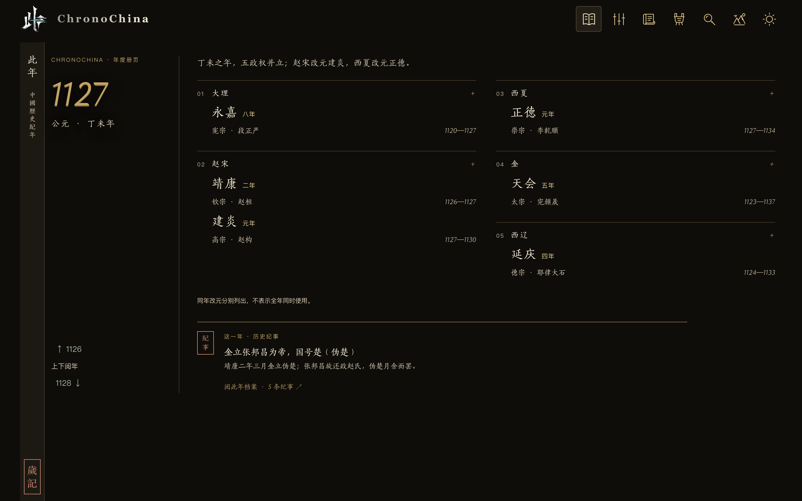
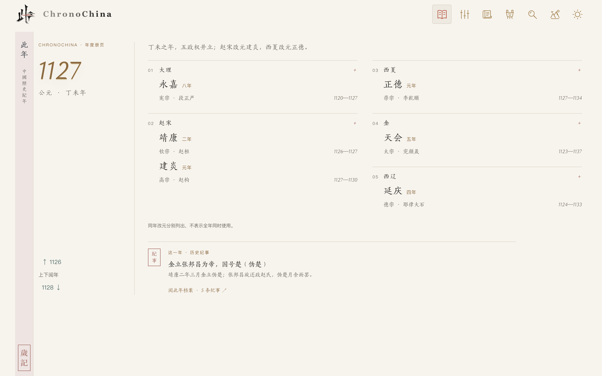
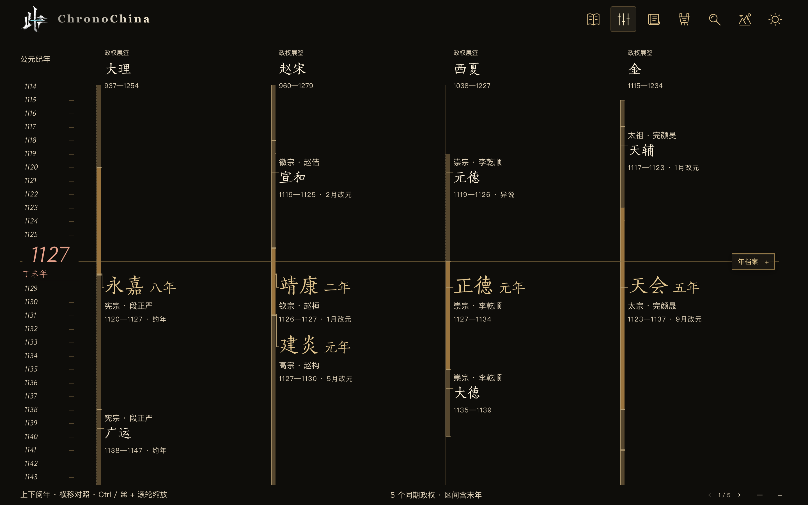
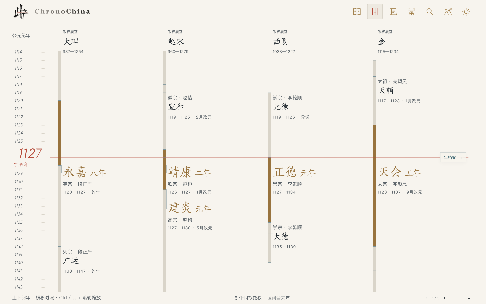
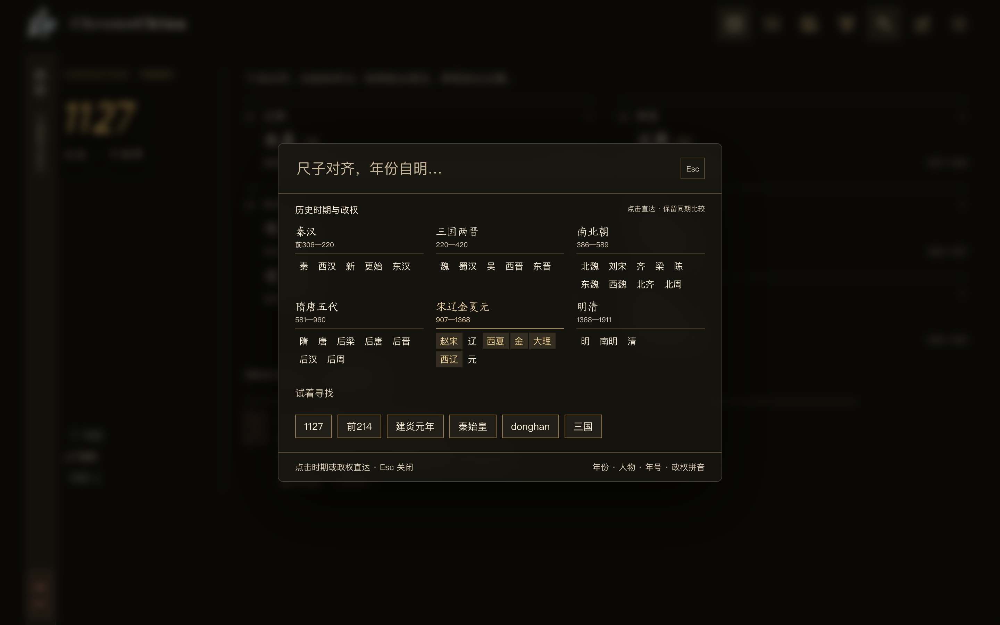
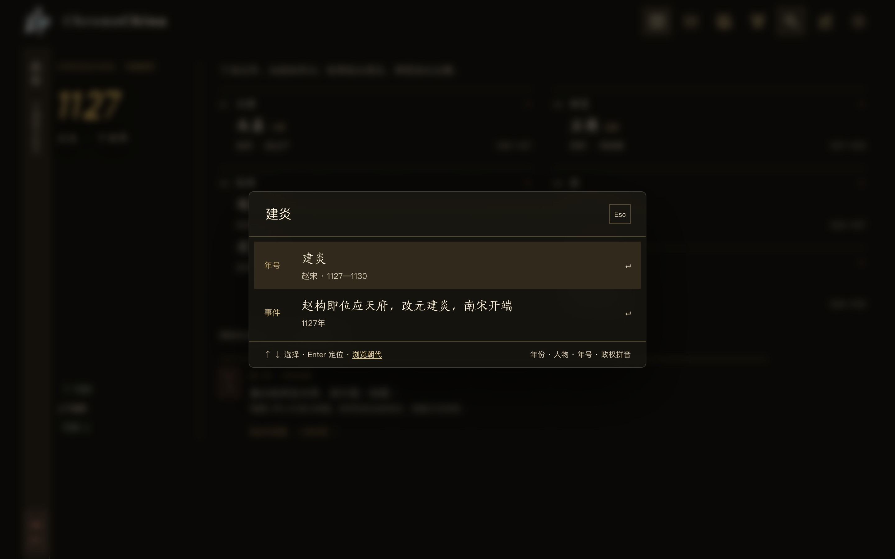

[English](README.en.md) · 简体中文

<p></p>

# 此年 · ChronoChina

**此年，山河同阅。** —— 以一个年份为轴，把同时代的政权、年号与史事摆在一行里。

## 创作初衷

我平时做的多是空间数据，习惯先把东西放进一个坐标系里：有原点、有尺度，位置才说得清。回头读史时却发现，时间没有这样一把尺子——朝代一卷一卷地写，读者也就一卷一卷地读。

第一次被绊住，是想弄清 1127 年到底有哪几个年号在行用。翻下去才知道：赵宋从靖康走到建炎，大金已行天会，西夏是正德，西辽在延庆，大理还在永嘉。它们分属不同的卷次，却落在同一年；读的时候，只能自己在心里把它们摆成一行。

这个站想做的就是先把尺子对齐：先给你一个年份，再横向看同期政权与年号；要追问时，每条纪年都能翻到依据，没收录的年份也照实写着——空白不等于无史。尺子对齐了，规矩立住了，读史、学史才不烧心（bushi）。

所以它不做地图，也不做装饰性的长卷。「此年，山河同阅」既是取景框，也是取舍：把「同时」还给历史，把判断留给你。

## 项目名称

- **网站名称**：此年 · ChronoChina（ChronoChina = Chronology + China）
- **Slogan**：此年，山河同阅。
- **Logo**：印章式「此年」朱文方印，见 `public/favicon-art.png`。

## 项目简介

中国历史时序图谱。它建立一个统一的历史时间坐标系：任何一年，都能同时看到公元年、干支、同期并立的政权、各自行用的年号与当年发生的事。

与展示型年表不同，这里的每个条目都可定位、可核对、可追溯来源——异说标虚线，约数标徽记，缺口写清楚。全部数据为静态 JSON，无后端、无数据库，打开即用。

适合想弄清「这一年到底有几个政权、各自纪年是什么」的读者，也适合作为教学与写作查年的时间参照。

## 在线预览

**<https://cinian.laneqiyu.cn>** —— 由 Cloudflare Pages 托管（备用地址 <https://chronochina.pages.dev>）。

不想装环境也可以直接看；要改代码，就按[本地运行](#本地运行)起一个开发服务器。构建产物为纯静态，`base: './'` 也适配任意子路径。

## 界面预览

**阅年 · 暗色**：一年一页的历书版式。年份为主、干支为辅，同期政权按都城由南向北编为 01—05，页首一句题记点出当年格局。



**阅年 · 浅色**：同一版式换作宣纸白，朱砂与描金只落在年份、印章与横线上。



**并世 · 暗色**：纵向时间画布。左为公元纪年，中央朱红横线即当前年，同期政权各占一列展签，年号按真实起讫画期间条。



**并世 · 浅色**：同一把尺子，换一套纸墨。



**搜索 · 浏览**：`Ctrl / ⌘ + K` 唤起，输入框留空时就是朝代目录——九大时期、周边政权与各政权条目都在这一页。



**搜索 · 检索**：输入年号、年份、干支、人物或政权拼音，回车即定位到那一年。



## 核心功能

- **阅年** —— 一年一页：年份、干支与同年并立政权数；页首题记由当年改元自动生成（「丁未之年，五政权并立；赵宋改元建炎，西夏改元正德。」）；政权按都城由南向北编号，五个并立时自动分两栏；展开可见年号、君主、起讫与改元月份；滚轮 / `↑ ↓` / 滑动翻年。每页下缘可翻出「年度档案」，汇总当年史事、同期纪年与在世人物。
- **并世** —— 纵向多年对照：左栏公元纪年，中央朱红横线即当前年；当年存续政权各占一列展签，自南向北排列，年号按真实起讫画期间条，与当前年重合处展开年号、君主与改元月份；异说与约年另有标注；`Ctrl / ⌘ + 滚轮` 缩放时间密度，`‹ ›` 整组切换政权。
- **周边政权** —— 吐蕃、南诏、回鹘、渤海、新罗、契丹（建国前）与中原王朝并列于同一把年尺，可查赞普、诏王、可汗、渤海王与新罗王的在位与纪年；无汉式年号者注明纪年方式与世系依据。
- **搜索** —— `Ctrl / ⌘ + K`：留空是朝代目录，点击时期或政权直达开朝年并保留同期比较；输入后检索年份（`1127`、`前221`）、年号（`建炎元年`、`绍兴`）、干支（`丁未`）、人物别名（`秦始皇`）与政权拼音（`donghan`）。
- **年档案** —— 可拖动、可八向缩放、可调纸面透明度、可固定到侧栏的浮动记录，随当前年份更新；史事可按分类筛选。
- **君主档案** —— 点击年页或资料库中的君主，展开在位年数、年号、在位纪事与元年同期君主，可继续打开相邻君主的档案。
- **生僻字注音** —— 郢、嬴、亹、隗等字随文括注拼音，覆盖政权、君主、年号、纪事与遗产名录。
- **纪年资料库** —— 政权、君主、年号、起讫、干支、改元月份、异说与来源一表呈现，支持筛选与导出 CSV。
- **历史遗产** —— 162 处精选遗产，按类别 / 朝代 / 关键词筛选，可回跳始建年代。
- **明暗主题** —— 宣纸白 / 墨底金字，两套配色共用同一版式，只换纸墨不动版心；选择会被记住。
- **键盘与无障碍** —— 首行「跳到正文」直达主内容；`Esc` 关闭搜索与档案并把焦点交还原处；搜索为 `combobox`，方向键可选择。

## 技术栈

| 层 | 选型 |
|---|---|
| 前端 | React 18、TypeScript（strict）、原生 CSS + CSS 变量 |
| 构建 | Vite 5 |
| 时间映射 | d3-scale（年份 ↔ 像素） |
| 数据 | 静态 JSON，构建期读取，无后端、无数据库 |
| 数据脚本 | Node ESM + cheerio（仅开发期导入与校验） |

## 本地运行

要求 Node.js 18+。

```bash
npm install
npm run dev        # 开发服务器 http://localhost:5173
npm run build      # 类型检查 + 数据校验 + 构建到 dist/
npm run preview    # 预览构建产物
```

数据相关命令：

```bash
npm run validate   # 数据校验（改 data/*.json 后必跑，build 会自动执行）
npm test           # 日期、换算、搜索与档案布局回归测试
```

## 项目结构

| 目录 / 文件 | 用途 |
|---|---|
| `data/` | 静态数据：政权、君主、年号、事件、人物、遗产、来源 |
| `data/curated/` | 手工校订覆盖层，优先级最高 |
| `scripts/` | 数据导入、校验与回归测试 |
| `public/` | 字体、图标原稿、站点图标 |
| `src/views/` | 阅年、并世、纪年资料库、历史遗产 |
| `src/components/` | 搜索浮层、年档案、年份面板、图标 |
| `src/lib/` | 数据访问、时间与干支、搜索、换算 |
| `src/styles.css` | 时间画布、搜索浮层与全局版式 |
| `src/reading-collections.css` | 阅年册页、资料库与遗产页样式 |
| `docs/preview/` | README 界面预览图 |
| `index.html` | 页面入口 |

## 开发计划

**已完成**

- 全量纪元导入（90 政权 / 825 君主 / 1107 年号），干支与算法逐条互验；
- 春秋战国十四诸侯（周、晋、齐、楚、燕、鲁、宋、卫、郑、吴、越、赵、魏、韩）君主纪年补至前 770 年，并扩展秦的纪年；
- 全史事件库（5345 条，覆盖 2200 个年份）与 668 位人物、162 处遗产；
- 十六国十六政权及其旁支（冉魏、西燕、翟魏、代）、十国十政权及十国之外的岐、桀燕、清源军、归义军，以及大理、西夏、西辽的完整年号链；
- 吐蕃、南诏、回鹘、渤海、新罗、契丹（建国前）等周边政权补入并世对照，并补挂唐蕃、唐诏、唐回鹘、唐渤海、唐新罗、唐契丹相关纪事；
- 并世纵向对照、阅年历书册页、纪年资料库、历史遗产、玻璃搜索与年档案；
- 事件按军事、政治、外交、制度、人物、文化分类筛选；君主档案页汇总在位、年号、纪事与同期君主；
- 生僻字在政权、君主、年号、纪事与人物名后括注拼音（如「郢（yǐng）」）；
- 朝代目录并入搜索窗口，明暗双主题同版式，数据校验与回归测试。

**计划中**

- 史地联动：遗产坐标地图 + 深链「江山时序」，不自建疆域图；
- 遗产名录向全国重点文保全量扩展。

## 贡献指南

- **反馈问题**：在 [Issues](https://github.com/Linqiyu-0921/ChronoChina/issues) 说明现象、浏览器与复现步骤；史实问题请附来源。
- **提交修改**：Fork 后开分支，改动尽量单一；涉及 `data/*.json` 必须先跑 `npm run validate`，提交前跑 `npm run build` 与 `npm test`。
- **史实准则**：不接受无来源的纪年改动；异说须标注 `disputed` 并写明依据；不把农历日期自动换算成公历日。

## 许可证

| 部分 | 协议 |
|---|---|
| 代码 | [MIT](LICENSE) |
| 数据（`data/`） | [CC BY-SA 4.0](LICENSE-DATA.md) |
| 图标与描金线稿（`public/assets/icons/`） | CC BY 4.0 |
| 字体（`public/fonts/`） | 第三方字体，不随本仓库授权 |

转载或改编请保留署名：**此年 · ChronoChina（Linqiyu）**；使用数据时另需保留维基百科《中国历史年表》的来源署名。

## 致谢

- 事件编年参照 [维基百科《中国历史年表》](https://zh.wikipedia.org/wiki/中国历史年表)（CC BY-SA 4.0，文字均经独立改写）；事件与人物另有一部分系编者依通行年表整理、标「编者整理（待复核）」，仍需逐条溯源；
- 先秦至元的逐年事件抽取自 [国学大师《资治通鉴》《续资治通鉴》电子本](https://www.guoxuedashi.com/a/54cxdt/)（公有领域古籍，节引原文）；公元年取自底本标注或按本站年号表反算；
- 明清两代逐年事件抽取自 [《明史》《清史稿》本纪](https://www.gxdq.com/24shi/)（公有领域古籍，节引原文）；
- 春秋战国诸侯君主纪年据 [《史记·十二诸侯年表》《六国年表》](https://www.gxdq.com/a/1y/) 整理，部分末代君主起讫有异说；
- 吐蕃、南诏、回鹘、渤海君主世系据 [两《唐书》四夷传](https://www.gxdq.com/a/17kcea/) 整理，新罗据 [《三国史记》](https://zh.wikisource.org/wiki/三國史記)，契丹建国前世系据 [《辽史》](https://zh.wikisource.org/wiki/遼史)；周边政权多元汉式年号，公元年多为约数；
- 少数仍无史事的年份，据 [江山历史地图](https://deanchen.me/jiangshan-map/) 的纪年条目补齐，标题节引并标注来源，未逐条回核原始史料；
- 年号起讫与异说核对参照 [Y. T. Liu 中国历史纪年表](https://ytliu0.github.io/ChineseCalendar/era_names_simp.html)；
- 纪元数据导入源为 [中国历代纪元表](https://home.olemiss.edu/~gg/lidaijiy.htm)；
- 遗产条目参照 UNESCO 世界遗产名录与全国重点文物保护单位公开名录；
- 开源依赖：[React](https://react.dev/)、[Vite](https://vite.dev/)、[d3-scale](https://github.com/d3/d3-scale)；
- 排版字体为宋刻体（简 / 繁），随站内置，对外分发请自行确认字体授权。
